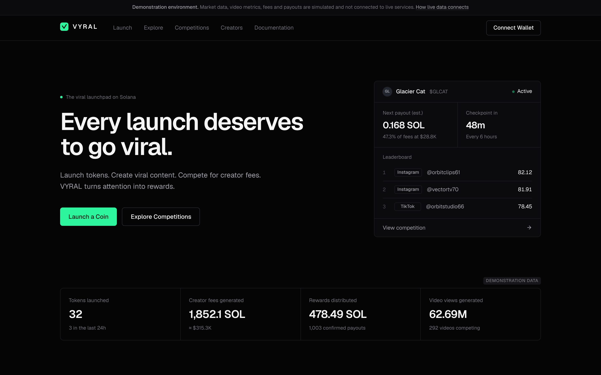
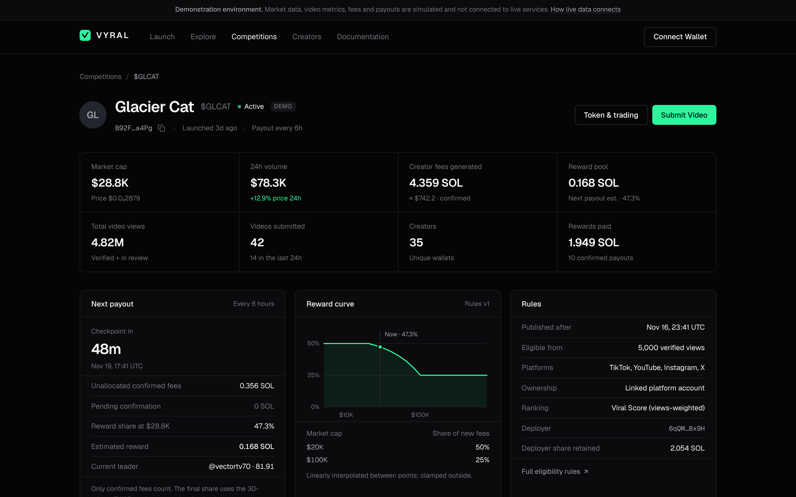
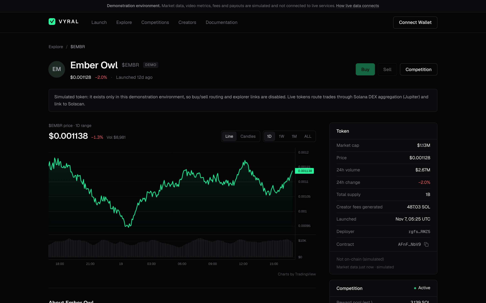
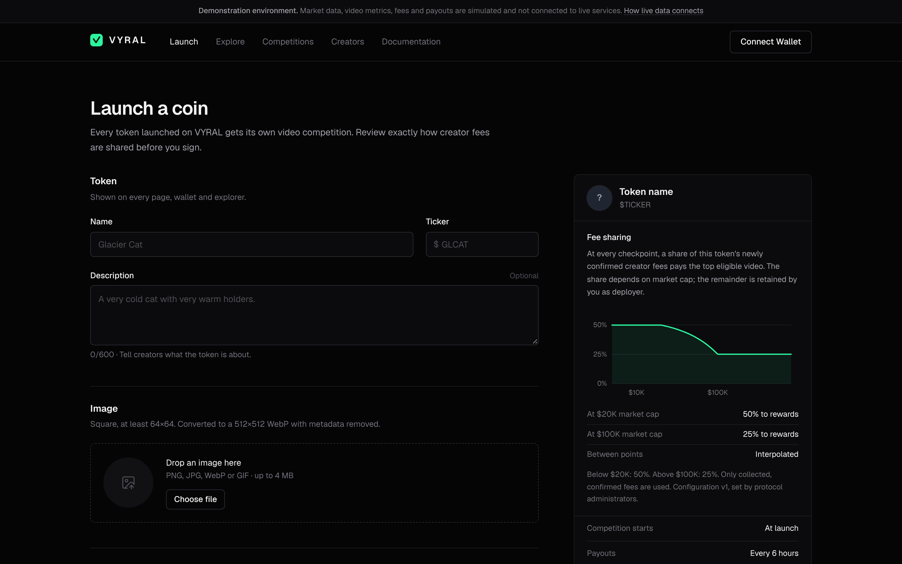
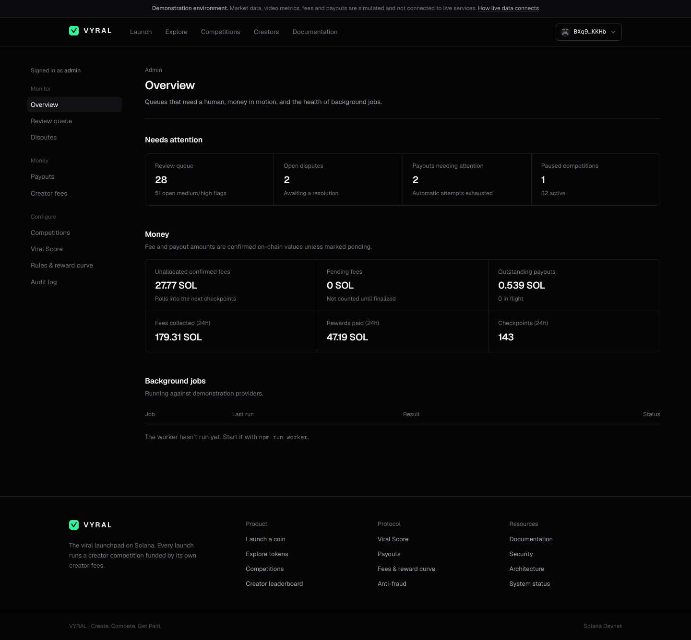

# VYRAL — the viral launchpad on Solana

**Create. Compete. Get Paid.**

Every token launched on VYRAL gets its own continuous video competition. Creators publish short videos about the token on TikTok, YouTube Shorts, Instagram Reels or X, submit the links with their Solana wallet, and compete on a cross-platform **Viral Score**. At every payout checkpoint (every 3 or 6 hours), the top eligible video earns a share of the token's confirmed creator fees — paid on-chain and publicly verifiable.



| Competition | Token & trading |
| --- | --- |
|  |  |

| Launch | Admin |
| --- | --- |
|  |  |

---

## Quick start

Requirements: Node.js ≥ 20.9 (22 recommended) and PostgreSQL 16.

```bash
docker compose up -d                      # local PostgreSQL (or use your own)
cp .env.example .env.local                # then fill in the two secrets below
openssl rand -hex 32                      # → SESSION_SECRET
openssl rand -base64 32                   # → TOKEN_ENCRYPTION_KEY
npm install
npm run db:reset                          # migrate + seed demonstration data
npm run admin:add -- <your-wallet>        # grant your wallet the admin role
npm run dev:all                           # web app + background worker
```

Open http://localhost:3000 and connect Phantom, Solflare or any Wallet Standard wallet. By default every external service runs on a **clearly-labelled simulation**: the site shows a demonstration notice, and simulated tokens, metrics, fees and payout signatures are marked as such.

## Scripts

| Script | Purpose |
| --- | --- |
| `npm run dev` / `npm run worker` | Web app / background worker (run both, or `npm run dev:all`) |
| `npm run build` / `npm start` | Production build / server |
| `npm run vercel-build` | Hosted build: migrate → seed demo data if the database is empty (`SEED_DEMO_DATA`) → grant `ADMIN_WALLETS` → `next build` |
| `npm run db:migrate` | Apply SQL migrations (`drizzle/`) |
| `npm run db:seed` / `npm run db:reset` | Seed demo data / drop, migrate and seed (development only) |
| `npm run admin:add -- <wallet> [admin\|reviewer]` | Grant an administrative role (audit-logged) |
| `npm test` | Unit tests + PostgreSQL integration tests (needs `TEST_DATABASE_URL`) |
| `npm run e2e` | Browser end-to-end suite against a running dev server (resets the dev database) |
| `npm run lint` / `npm run typecheck` | ESLint / TypeScript |

## Architecture

```
src/
  app/                 Next.js 16 App Router pages + API route handlers (/api/*)
  components/          Design system (ui/), charts, wallet, competition, admin
  content/docs.tsx     Documentation (renders live protocol parameters)
  lib/
    scoring/           Viral Score engine + data-driven multiplier calibration
    fraud/             Fraud detectors (pure) and risk routing
    rewards/           Reward curve, TWAP reference market cap, allocation math
    services/          Transactions: submissions, checkpoints, payouts, launch, admin…
    providers/         External integrations behind interfaces (mock | live)
    auth/ security/    Sign-In With Solana, sessions, rate limits, encryption
    config/            Versioned, audit-logged protocol configuration
    queries/           Read models for pages and the public API
    db/                Drizzle schema (PostgreSQL)
  worker/              Background jobs with PostgreSQL advisory locks
drizzle/               Migrations, incl. database-enforced integrity rules
tests/                 Engine unit tests + payout integration tests
e2e/                   Playwright end-to-end suite with an injected test wallet
```

**Rendering.** Pages use Cache Components / Partial Prerendering: a static shell is served instantly while database-backed sections stream in behind `<Suspense>`.

### Providers

Every external dependency sits behind an interface with a development implementation. Going live is configuration.

| Variable | Development (default) | Live |
| --- | --- | --- |
| `SOCIAL_PROVIDER` | `mock` — simulated metrics | `live` — YouTube Data API v3, TikTok Display API, Instagram API with Instagram Login, X API v2, with OAuth account linking |
| `LAUNCH_PROVIDER` | `simulated` — signed launch intent, no on-chain token | `pumpfun` — one transaction creates the coin on pump.fun (`create_v2`), splits its creator fees 50/50 between the reward vault and the deployer and revokes the split's admin; VYRAL signs for the mint, the deployer's wallet signs and sends, and the split is verified on-chain before the competition opens (`lib/launch/pumpfun.ts`) |
| `PRICE_PROVIDER` | `mock` | `jupiter` — Jupiter price + on-chain supply (RPC); DexScreener volume for display |
| `FEE_PROVIDER` | `mock` | `pumpfun` — the keeper distributes each coin's creator fees (permissionless sweep + `distribute_creator_fees_v2`, paid by the vault); the vault's balance change is that coin's fee, counted at finality |
| `PAYOUT_EXECUTOR` | `simulated` — random signatures, never linked to explorers | `solana` — SOL transfers from the fee vault, signed by a **remote signer** (KMS/custody) or, with `PAYOUT_ALLOW_HOT_WALLET=true`, an environment keypair with a per-payout cap (`PAYOUT_MAX_LAMPORTS`) |
| `STORAGE_PROVIDER` | `local` | `pinata` (IPFS) |

### Background jobs (`npm run worker`)

| Job | Interval | What it does |
| --- | --- | --- |
| `sample-prices` | 1 min | Price + supply samples (TWAP inputs), candles, token market data |
| `sync-fees` | 1 min | New creator-fee observations (pending) and finality confirmations |
| `sync-metrics` | 2 min | Tiered metric refresh → snapshots → fraud checks → Viral Score |
| `checkpoints` | 30 s | Processes due checkpoints idempotently |
| `payouts` | 15 s | Builds, broadcasts, confirms and retries transfers |
| `maintenance` | 1 h | Prunes nonces, sessions, rate-limit windows, old samples |

Each job takes a PostgreSQL advisory lock, so several worker replicas can run safely. `npm run worker -- --once` runs one pass (cron-style deployments).

On serverless hosts without a long-running process, `GET /api/cron/tick` runs whichever jobs are due (same code, same locks). Protect it with `CRON_SECRET` and call it once a minute.

## Deploying to Vercel (free tier)

1. Create a PostgreSQL database (e.g. [Neon](https://neon.tech) free tier) and copy its connection string.
2. Import the repository in Vercel (framework preset **Next.js**, root `./`). `vercel.json` sets the build command to `npm run vercel-build`.
3. Environment variables:

   | Variable | Value |
   | --- | --- |
   | `DATABASE_URL` | Postgres connection string (`?sslmode=require`) |
   | `SESSION_SECRET` | random string, ≥ 32 characters |
   | `TOKEN_ENCRYPTION_KEY` | `openssl rand -base64 32` |
   | `CRON_SECRET` | random string |
   | `STORAGE_PROVIDER` | `database` (Vercel has no persistent disk) |
   | `TRUST_PROXY` | `true` |
   | `APP_URL` | `https://<your-project>.vercel.app` (or your domain) |
   | `ADMIN_WALLETS` | your Solana wallet address (optional, comma-separated; granted the admin role on every deploy) |

4. Deploy, then have an external scheduler (e.g. cron-job.org) call `https://<your-domain>/api/cron/tick?key=<CRON_SECRET>` every minute.

## How the core mechanisms work

**Viral Score** (`lib/scoring/viral-score.ts`): platform multipliers convert raw metrics into baseline units; likes and comments only count up to a share of views (so bought engagement cannot outrank reach); each metric is log-normalised against a reference ceiling; weights default to views 50 / likes 25 / comments 25. Platform multipliers start from published benchmarks (`benchmark-sqrt-v1`: √ of the TikTok-to-platform ratio of average views, likes and comments per video from Metricool 2026 / Socialinsider 2026, neutral where sources disagree; X uses the Instagram values as a labelled estimate because no comparable data exists; each value carries its citation) and are replaced by calibration on VYRAL's own verified history (`median-rate-ratio-v1`, with small-sample shrinkage, combined with the view multiplier) or manual values with a required source citation. Entries must contain the coin's contract address in the post text (checked on submit and on every metrics refresh). Payouts require 500 verified views by default; `scripts/config-upgrade.ts` moves existing databases from earlier defaults without overriding admin changes.

**Anti-fraud** (`lib/fraud/detectors.ts`): view spikes, purchased views/likes (engagement decoupling), unnatural ratios, machine-like uniform growth, round-number increments, platform purges (metric regression), reused content (perceptual thumbnail hashes), duplicates, submission velocity, shared social accounts / networks, and self-dealing. Medium/high flags route a video to human review; nothing is rejected automatically. Reviews, flags and disputes are handled in the admin dashboard.

**Payouts** (`lib/services/checkpoints.ts`, `lib/services/payouts.ts`): a checkpoint runs in one transaction keyed by *(competition, scheduled time)* — confirmed, unallocated fees only; top eligible video; reference market cap = 30-min TWAP × on-chain supply; reward share from the competition's curve; integer-lamport allocation; fees roll over when there is no fee, price, winner or the reward is below the dust threshold. Transfers persist their signature before broadcast, allow at most one in-flight attempt per payout (database constraint), and only retry after the previous blockhash has expired. Failed payouts become claimable by the creator (fresh signature) or can be retried, settled with an on-chain-verified external transfer, or voided by an admin.

**Security**: Sign-In With Solana (single-use nonces, ed25519 verification), HttpOnly sessions, same-origin enforcement for mutations, PostgreSQL-backed rate limits, role-based admin access checked in every admin page and API route, append-only audit log enforced by a database trigger, AES-256-GCM encryption of OAuth tokens, keyed hashing of IPs, server-side image re-encoding.

## Testing

```bash
npm test          # 35 unit + integration tests (scoring, calibration, curve, TWAP, fraud,
                  # checkpoint idempotency under concurrency, payout state machine, audit immutability)
npm run e2e       # 16 browser checks: wallet sign-in, submission, duplicate & pre-launch rejection,
                  # launch, admin review/payout actions, CSRF, auth, forged signatures, rate limits
```

Integration tests run against `TEST_DATABASE_URL` (put it in `.env.test.local`).

## Going live — checklist

Step by step (German): [GO-LIVE.md](GO-LIVE.md). **Admin → Go live** shows what is still missing and runs the one-time steps (lookup table, launch simulation against mainnet, removing the demo data).

- [ ] Provision PostgreSQL with backups; run `npm run db:migrate`; **do not** run the demo seed.
- [ ] Set `APP_URL`, secrets, `TRUST_PROXY=true` behind a reverse proxy (per-client rate limits).
- [ ] pump.fun launches: `LAUNCH_PROVIDER=pumpfun`, `FEE_PROVIDER=pumpfun`, then create the launch lookup table and run the launch simulation in **Admin → Go live** (or `npm run pumpfun:lut` / `npm run pumpfun:simulate`).
- [ ] Dedicated Solana RPC (`SOLANA_RPC_URL`), reward vault (`FEE_VAULT_ADDRESS`) and its signer: a remote signer (`REMOTE_SIGNER_URL`/`TOKEN`) or a capped hot wallet (`PAYOUT_SIGNER=env-keypair`, `PAYOUT_ALLOW_HOT_WALLET=true`).
- [ ] Platform API access: YouTube Data API key + Google OAuth client; TikTok Login Kit + Display API (`video.list`); Instagram API with Instagram Login (`instagram_business_basic`, `instagram_business_manage_insights`); X API with OAuth 2.0. Each requires the platform's app review.
- [ ] Switch providers to live values and run the worker; confirm `/api/health` and the admin overview job table.
- [ ] Review every default in **Admin → Rules** and **Viral Score**; calibrate multipliers once enough verified data exists.
- [ ] Obtain legal advice on token launches and creator rewards for your jurisdictions.
